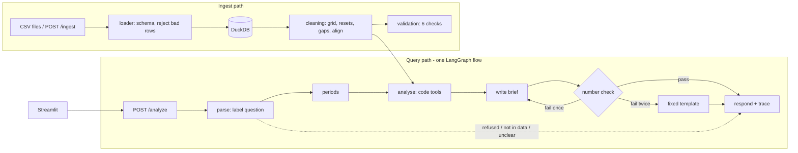

# Factory Energy Cost Decomposition and Savings Agent

Explains why a factory's electricity bill changed, separates price, volume, product mix and weather from
waste, backs any waste claim with meter evidence, and recommends actions with savings ranges and payback.

**One rule runs through the whole design: code produces every number, the LLM only labels the question and
words the brief.** A checker then matches every number in the brief to a tool result.

## Run it

```bash
cp .env.example .env                 # MOCK_LLM=true works with no model; set LLM_PROVIDER and a key for a real one
docker compose up --build            # API http://localhost:8000 (docs at /docs), UI http://localhost:8501
```

Without Docker:

```bash
pip install -r requirements.txt
python scripts/load_data.py data/sample --reset        # loads the four CSVs and prints the six validation checks
uvicorn app.api:app --port 8000                        # API
streamlit run ui/streamlit_app.py                      # UI (second terminal)
pytest -q                                              # 35 tests
python scripts/run_eval.py                             # evaluation -> eval/report.md
```

## Sample requests

```bash
curl -s localhost:8000/health
curl -s -X POST localhost:8000/analyze -H 'Content-Type: application/json' -d '{"question":"Why did the bill go up 15%?"}'
curl -s -X POST localhost:8000/analyze -H 'Content-Type: application/json' \
     -d '{"question":"What should we do first?","period":"2026-Q3","compare_to":"2026-Q2"}'
curl -s -X POST localhost:8000/analyze -H 'Content-Type: application/json' -d '{"question":"What if the tariff were 10% lower?"}'
curl -s -X POST localhost:8000/analyze -H 'Content-Type: application/json' -d '{"question":"What will the tariff be next year?"}'
curl -s localhost:8000/trace/en-xxxxxx                 # run_id from any answer
curl -s localhost:8000/validate                        # the six validation checks as JSON

# add or correct data while running (late data drop); the answer includes the bill split before and after
curl -s -X POST localhost:8000/ingest -F file=@data/late_drop/tariff.csv -F table=tariff
curl -s -X POST localhost:8000/ingest -F file=@data/late_drop/meter_15min.csv -F 'meta={"table":"meter_15min"}'
curl -s -X POST localhost:8000/analyze -H 'Content-Type: application/json' -d '{"question":"What changed after the correction?"}'
```

**Loader for judge data** (guide 4.7). Three equivalent ways, all in the Annex B schema:

```bash
python scripts/load_data.py /path/to/folder --reset                       # API stopped
python scripts/load_data.py /path/to/folder --api http://localhost:8000   # API running (uploads through /ingest)
curl -s -X POST 'localhost:8000/admin/load?folder=/path/in/container&reset=true'
```

`--reset` (or `reset=true`) empties the store first. Without it, rows with the same key are replaced and new rows are added.
Through `/ingest` there is no reset: to replace the sample data completely, use one of the two reset options.

## Architecture



| Layer | Choice | Why |
|---|---|---|
| UI | Streamlit, one page | Scored only for usability. Calls the API over HTTP, so it shows what a judge's curl gets |
| API | FastAPI + Pydantic v2 | Contract in `app/schemas.py` |
| Orchestration | LangGraph, 6 nodes, at most 2 LLM calls | Steps are fixed, so there is one flow, no second agent. The graph gives routing by question type, the capped retry and the trace |
| Analysis | pandas, numpy, statsmodels | `app/tools/`: billing, baseline, bridge, assets, waste, savings. No LLM in these files |
| Store | DuckDB (one file) | Fast over 15-minute data; also holds traces and earlier results for before/after |
| LLM | `LLM_PROVIDER` = ollama, openai, anthropic or gemini; `MOCK_LLM=true` | Labels the question, words the brief. Never calculates, never calls tools |
| Retrieval | None | Inputs are numeric tables; retrieval would add risk and no accuracy |

```
app/        api.py  graph.py  analysis.py  intents.py  writer.py  numcheck.py  llm.py
            loader.py  cleaning.py  validation.py  store.py  schemas.py  config.py
app/tools/  billing.py  baseline.py  bridge.py  assets.py  waste.py  savings.py
scripts/    generate_data.py  load_data.py  validate_data.py  run_eval.py
ui/         streamlit_app.py
tests/      test_tools.py  test_api.py
eval/       cases.json  truth.json  report.md  results.json
docs/       DATA_CARD.md  sample_traces/  sample_response_decomposition.json
config.yaml every assumption in one place
```

## How the bill is split (R2 to R4)

B = bill, E = kWh on the main meter, p0 = average price of the reference quarter (B0 / E0).

1. **Bill.** Every 15-minute reading is priced at the tariff in force at that moment, so a price change in the middle of a quarter needs no special case.
2. **Tariff slice** = B1 - E1 x p0: the new energy at the new prices minus the same energy at the old average price.
3. **Energy at the old price** = (E1 - E0) x p0, split into four slices with the baseline.
4. **Baseline.** Linear regression of daily kWh on a working-day flag, units per product, cooling and heating degree-days, fitted on the **reference quarter only** (fitting on the new quarter would teach the model that the waste is normal). Rates that cannot be negative are not allowed to be.
5. **Volume** = extra units at the reference mix, plus the calendar effect (one more day, different number of working days). **Mix** = this quarter's units at this quarter's mix minus the same units at the reference mix. **Weather** = change in degree-days times the weather rate.
6. **Waste** = actual extra kWh minus what the baseline explains. It is the growth in unexplained energy.

Each slice is divided by B0. The five percentage points sum to the total change by construction; the printed
values are rounded to two decimals and any rounding remainder (a few hundredths at most) goes on the largest slice.

**Ranges.** Volume, mix, weather and waste: 5th to 95th percentile over 200 refits of the baseline on resampled
days, each in both orders (volume before mix, mix before volume). Tariff: the price change valued on the new
quarter's energy and on the reference quarter's energy.

**When is the leftover called waste?** Only when a named sub-meter shows it: its load while the production lines
are stopped must be above its own reference pattern after adjusting for weather (`app/tools/waste.py`). Otherwise
the slice is reported as unexplained. The bridge row is always named `waste`, as the guide fixes five causes.

## Assumptions (all in `config.yaml`, all echoed in API answers)

| Open point in the guide | What we assume | Where |
|---|---|---|
| Which hours are peak | 06:00 to 22:00 local | `peak_hours` |
| Factory time zone | UTC | `factory_timezone` |
| What "idle" means; shift hours | Production-line meters (`line*`) not running. Shift text is used only if no line meter exists | `production_meter_prefixes`, `shift_hours` |
| Emission factor (no file has one) | 0.4 kg CO2e per kWh, the guide's sample value | `emission_factor_kg_per_kwh` |
| Action cost, ease, recoverable share (no file has them) | A small stated table per asset type. **Costs must be in the tariff's currency**; the values shipped suit the sample data's price scale, so change them if judge data uses another scale | `actions` |
| Sub-meter tolerance | 5% of the main meter | `submeter_tolerance_pct` |
| Which meter is the bill | The main meter; the sub-meter gap is reported as unmetered | fixed |
| What a meter reset looks like | A negative reading, or one above 5x the meter's 99th percentile | `cleaning.spike_factor` |
| Corrected file through `/ingest` | Same key replaces the row. A tariff file replaces older prices only inside the time span it covers | `app/store.py` |
| Default periods | Latest loaded quarter against the one before it | `app/analysis.py` |

## Limitations

- **The weather slice is the weakest.** One mild reference quarter gives a weakly determined weather rate; its range, and the waste range with it, is wide. The answer says so when it applies.
- The waste slice also contains baseline error and random variation. See its range before quoting it.
- Meter evidence covers idle hours only. Whether a leak also runs during production is assumed in the high end of the savings range.
- Yearly savings scale the last 28 days of the quarter to a year. Payback depends on assumed costs.
- A load shift between peak and off-peak hours lands in the tariff slice.
- A product not made in the reference quarter has no learned rate; its energy falls into waste, and the answer flags it.
- What-ifs supported: tariff N% lower or higher, and tariff unchanged. Only prices change; energy is kept as measured.
- With `MOCK_LLM=true` questions are labelled by keyword rules, so unusual wording can end in `clarification_needed`.
- **Not verified in this build:** `docker compose up` has not been run (no Docker daemon was available where the code was written), and the four real LLM providers have not been called (no keys). The provider code in `app/llm.py` follows each vendor's documented HTTP API. **Run both before the demo.**

## Known edge cases and how they are handled

| Edge case (guide 4.4) | Handling |
|---|---|
| Sub-meters do not add up | Check 1 reports the gap per quarter; it is shown as unmetered energy, never forced to zero |
| Missing intervals | Up to 1 hour interpolated; longer gaps filled with the typical value for that time of day, and that day is left out of the baseline fit |
| Meter resets, duplicates | Removed and counted in validation checks 2 and 3 |
| Tariff change mid-quarter | Interval-level pricing |
| Mix shift without waste | Separate energy rate per product, so it lands in the mix slice |
| Hot period | Degree-days in the baseline; cooling meter compared with weather before any waste flag |
| Holiday logged as a normal shift | A day is "working" only if units were made and the line meters ran; check 5 lists the day |
| Unseen files, extra columns, bad rows | Extra columns ignored; bad rows rejected and counted; a wrong file is rejected, the API keeps running |

## Evaluation

`eval/report.md` (from `python scripts/run_eval.py`): 26 cases, method exact match with tolerance, two baseline
configurations compared on 8 generated datasets. Scores are on our own synthetic data and are optimistic; the
report says why. Re-run it with the real LLM before quoting the faithfulness and latency figures.

## Deliverables checklist (guide section 8)

- [x] README with architecture, run steps, curl samples, assumptions, limitations, edge cases
- [x] Validation script and output (`scripts/load_data.py`, `scripts/validate_data.py`, `GET /validate`), loader
- [x] Rule and model code with tests (`pytest -q`)
- [x] Evaluation set and report (`eval/`)
- [x] Data card (`docs/DATA_CARD.md`) and generator script
- [x] Three sample traces (`docs/sample_traces/`)
- [ ] `docker compose up` verified on a team laptop
- [ ] Real LLM tested, evaluation re-run with it
- [ ] Git repository with commits from every member, tagged `final`
- [ ] AI-usage disclosure, contribution statement and declaration below completed by the team

## AI-usage disclosure (complete before submission)

The first version of this repository (application code, generator, tests, evaluation runner, README) was generated
with an AI coding assistant (Claude) from the team's design review. Verified so far by: the test suite, the
evaluation against a planted answer key, and a live run of the API and UI.
**Team to add:** what each member reviewed, changed and can explain.

## Team contribution statement (complete before submission)

| Member | Workstream | Files |
|---|---|---|
| _name_ | Data: generator, loader, validation, cleaning, ingest, evaluation set, data card | `scripts/`, `app/loader.py`, `app/cleaning.py`, `app/validation.py`, `eval/` |
| _name_ | Analysis: baseline, bill split, ranges, what-if | `app/tools/billing.py`, `baseline.py`, `bridge.py` |
| _name_ | Waste, savings, UI | `app/tools/assets.py`, `waste.py`, `savings.py`, `ui/` |
| _name_ | Integration: API, LangGraph flow, LLM, number check, trace, Docker | `app/api.py`, `graph.py`, `analysis.py`, `intents.py`, `writer.py`, `numcheck.py`, `llm.py` |

## Declaration of original work

_To be signed by every member._
